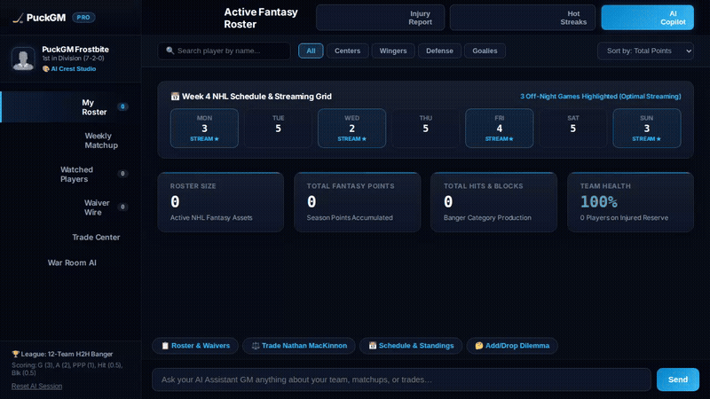

# PuckGM: The Autonomous Fantasy Hockey War Room 🏒

PuckGM is an AI-powered Fantasy Hockey Assistant General Manager built on the Google Agent Development Kit (ADK) and Vertex AI Agent Platform. It manages your active roster, scouts waiver wire targets, evaluates trade proposals, generates custom team graphics and video highlights, and answers strategic management questions with rich A2UI cards.



---

## ⚡ What PuckGM Actually Does

PuckGM pairs an LLM agent (`gemini-3.8-flash`) with dedicated Google Cloud enterprise services and domain-specific tools:

1. **Active Roster & Waiver Wire Management (Cloud Firestore)**:
   - Reads, scouts, and updates player fantasy status (`Roster`, `Waiver`, `Watchlist`) in a managed Google Cloud Firestore collection (`players`).
   - Tracks games played, goals, assists, total points, banger peripherals (hits and blocks), injury statuses, and fantasy outlook notes.

2. **Cross-Session Long-Term Memory (Vertex AI Memory Bank)**:
   - Uses `PreloadMemoryTool` to inject past manager preferences, trade discussions, and watched players into each conversation turn.
   - Emits session interactions to the managed Vertex AI Memory Bank via an `after_agent_callback` (`callback_context.add_session_to_memory()`), allowing PuckGM to remember your strategy and watchlist across sessions.

3. **Rich Visual Interface (A2UI - Agent to User Interface)**:
   - Returns interactive, structured A2UI cards (`Card`, `Column`, `Row`, `Text`, and `Image` components) natively processed by an `after_model_callback`.
   - Renders player headshots, statistics grids, and waiver recommendations directly inside the web UI.

4. **Multi-Asset Trade Machine (`analyze_trade`)**:
   - Compares multi-player trades in both Standard Points and Banger Leagues.
   - Calculates net differentials across season points, 5-game momentum, power-play points, hits, and blocks to deliver clear trade verdicts and risk warnings.

5. **AI Team Crest & Graphics Studio (Google Imagen 3 & Cloud Storage)**:
   - Generates high-definition team logos, rivalry posters, and franchise crests via Google's `gemini-3.1-flash-lite-image` model.
   - Saves artifacts to the agent runtime and uploads image bytes directly to a public Google Cloud Storage bucket (`gs://puck-gm-media-ab64a7`).

6. **AI Video Highlight Generation (Google Omni `gemini-omni-flash-preview`)**:
   - Generates short, dynamic hockey highlight videos and goal teasers via Google's Omni model in the `global` region using the Vertex AI Interactions API.
   - Registers generated video artifacts in `tool_context.save_artifact` and uploads bytes directly to public Cloud Storage.

7. **Official NHL Schedule & Standings Integration**:
   - Fetches live NHL team schedules and divisional standings from public NHL roster and standings APIs.
   - Highlights 7-day schedule matchups and off-night streaming opportunities (`MON`, `WED`, `FRI`, `SUN`).

8. **Secure Calculations Sandbox (Agent Engine Sandbox)**:
   - Configured with an `AgentEngineSandboxCodeExecutor` on Vertex AI to execute isolated Python computations for statistical projections and scoring calculations.

---

## 🛠️ Repository Architecture

```
puck-gm/
├── app/
│   ├── agent.py                 # Core ADK root_agent, tools, callbacks, and sandbox
│   ├── a2ui_utils.py            # A2UI callback and surface parser
│   └── a2ui_instruction_cache.py# Cached system instructions for A2UI schemas
├── frontend/
│   ├── main.py                  # FastAPI server connecting to deployed agent via A2A protocol
│   ├── static/
│   │   └── index.html           # Modern dark-slate fantasy hockey platform UI
│   └── requirements.txt         # FastAPI, a2a-sdk, httpx, google-auth, uvicorn
├── agents-cli-manifest.yaml     # ADK agent metadata and deployment manifest
├── demo.gif                     # High-definition looping walkthrough of the platform
└── README.md                    # Project documentation
```

---

## 🚀 Local Setup & Run Instructions

### Prerequisites
- Python 3.11+ or 3.12+
- Google Cloud SDK (`gcloud`) authenticated with Application Default Credentials (`gcloud auth application-default login`)
- Access to your Google Cloud project with Vertex AI and Cloud Firestore enabled

### 1. Configure Environment Variables
Set your Google Cloud project and Agent Engine deployment identifiers:
```bash
export GOOGLE_CLOUD_PROJECT="<YOUR_GCP_PROJECT_ID>"
export AGENT_ENGINE_RESOURCE_NAME="<YOUR_AGENT_ENGINE_RESOURCE_NAME>"
export AGENT_DIRECTORY="app"
```

### 2. Install Frontend Dependencies
From the repository root, install the web server packages into a virtual environment:
```bash
cd frontend
python3 -m venv .venv
source .venv/bin/activate
pip install -r requirements.txt
pip install google-cloud-firestore
```

### 3. Run the Platform Locally
Start the FastAPI server:
```bash
python main.py
```

Open your browser to the local port indicated in the terminal (default: port `8080`) to interact with the active roster, schedule optimizer, trade machine, and PuckGM War Room AI.
